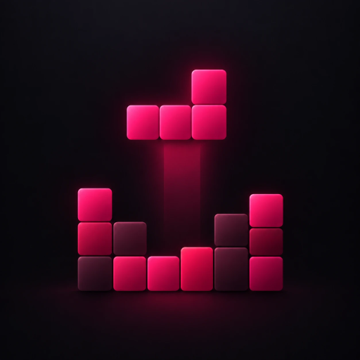
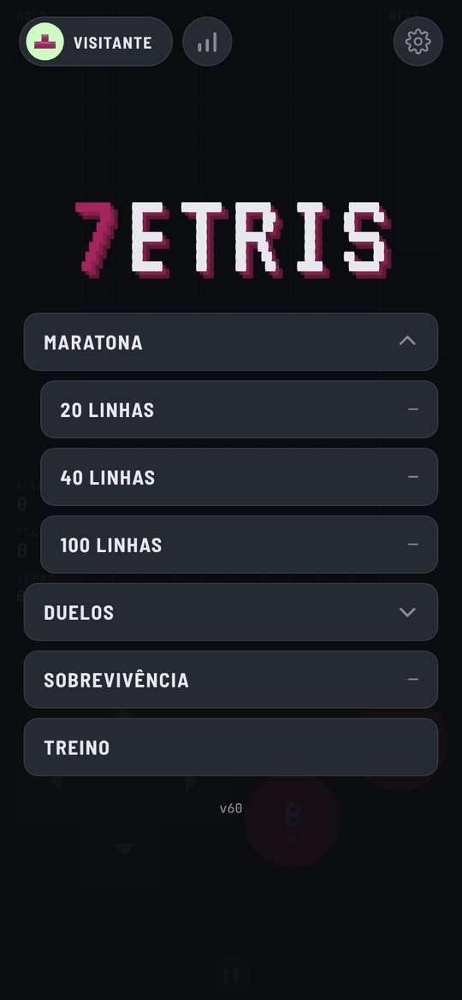
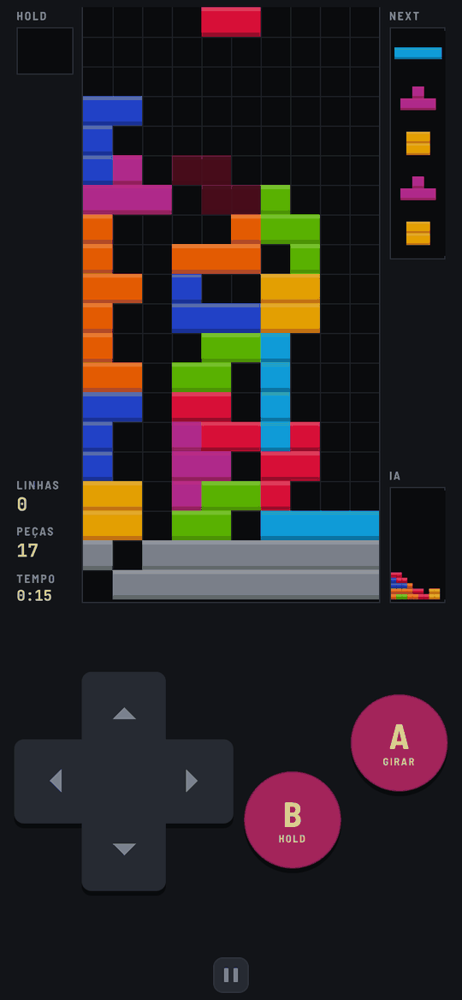
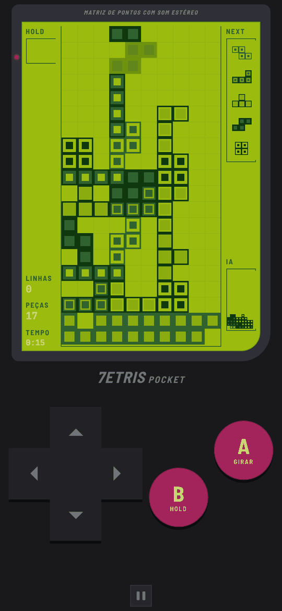
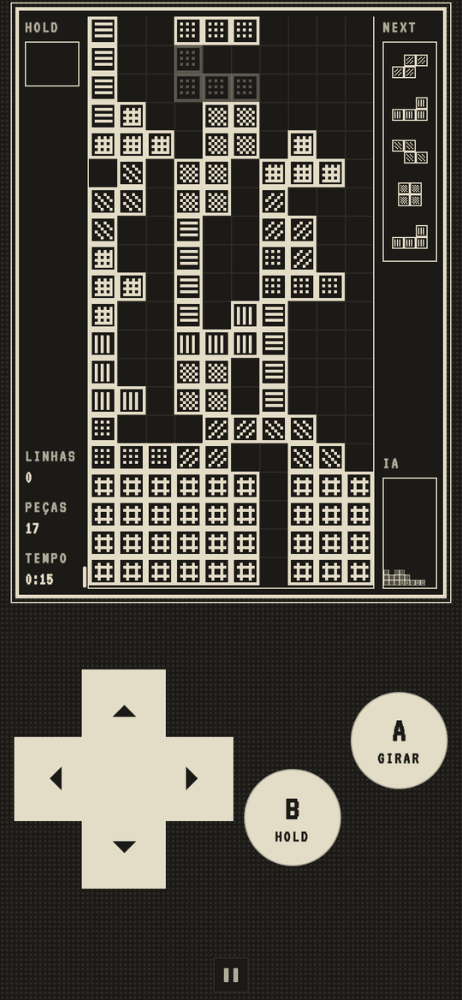

<div align="center">



# 7etris

**Blocos que caem, feito para o celular.** Maratona, sobrevivência, duelos contra a IA e contra amigos, ranking online e 12 skins.

[](https://mrcelomn.github.io/7etris/)


<br>

&nbsp;
&nbsp;
&nbsp;


</div>

---

## 📲 Instalar no celular

O 7etris é um **app web**: não vem da App Store nem da Play Store. Você abre o site uma vez, adiciona à tela inicial e depois ele abre em tela cheia, como qualquer app, e funciona até sem internet.

### iPhone

1. Abra **[mrcelomn.github.io/7etris](https://mrcelomn.github.io/7etris/)** no **Safari**.
2. Toque no botão **Compartilhar** (o quadrado com a seta para cima).
3. Role e toque em **Adicionar à Tela de Início**, depois em **Adicionar**.
4. Abra o 7etris pelo ícone novo na tela de início.

> 🔇 **Som no modo silencioso:** em *Ajustes → Áudio*, ligue **Tocar no silencioso** para ouvir o jogo com a chave do iPhone no silencioso. Ligado, ele pausa a música de outros apps (como o Spotify); desligado, toca junto com eles.

### Android

1. Abra **[mrcelomn.github.io/7etris](https://mrcelomn.github.io/7etris/)** no **Chrome**.
2. Toque no menu **⋮** no canto de cima.
3. Toque em **Adicionar à tela inicial** (ou **Instalar app**) e confirme.
4. Abra o 7etris pelo ícone novo.

### Atualizações

O app se atualiza sozinho sempre que abre com internet. A versão aparece no rodapé do menu (por exemplo, **v60**). Se ela não mudar, feche o app por completo (tire-o da lista de apps abertos) e abra de novo.

---

## 🎮 Modos de jogo

| Modo | Como funciona |
|---|---|
| **Maratona** | Limpe **20**, **40** ou **100** linhas no menor tempo possível. |
| **Sobrevivência** | A velocidade sobe um nível a cada 10 linhas, seguindo a curva oficial das Guidelines. Até onde você chega? |
| **Duelo contra a IA** | Três níveis: **Fácil**, **Médio** e **Difícil**. Linhas que você limpa viram lixo no tabuleiro do adversário. |
| **Duelo online** | Crie uma sala, mande o código de 5 letras para um amigo e joguem um contra o outro, cada um no seu celular. |
| **Treino** | Sem tempo, sem pressa, sem aceleração. |

### Regras dos duelos

- Limpar **2, 3 ou 4 linhas** de uma vez manda **1, 2 ou 4 linhas** de lixo para o adversário.
- **Combos** (peças seguidas que limpam linhas) mandam lixo extra.
- O lixo que está para chegar pode ser **cancelado** limpando linhas antes.
- Depois de **2 minutos**, linhas sólidas começam a subir dos dois lados até alguém perder.
- Todo duelo começa com uma contagem **3, 2, 1**.

---

## 🕹️ Controles

| Botão | Ação |
|---|---|
| **◀ ▶** | Mover a peça (segure para deslizar) |
| **▼** | Descer mais rápido |
| **▲** | Soltar a peça de vez |
| **A** | Girar |
| **B** | Guardar a peça (*hold*) |

Os controles são **seus**: em *Ajustes → Controles*, arraste para mudar de lugar, faça pinça para mudar o tamanho e escolha o formato do A e do B (redondo, arredondado ou quadrado).

Num computador com teclado: setas para mover, **↑** ou **espaço** para soltar, **X** para girar e **C** ou **Shift** para guardar.

---

## ✨ Recursos

- **12 skins de peças**: Clássica, Plana, Brilho, Relevo, Contorno, Monocromática, Preto e branco, Neon, Pastel, Gelatina, Game Boy e Obra Dinn. As duas últimas mudam o app inteiro.
- **Música e efeitos** em vários estilos (clássico, 8-bit, suave, madeira, piano, espacial…). Limpar linhas em sequência sobe a escala musical.
- **Tema claro e escuro.**
- **Conta sem e-mail nem senha**: só um nome e um código secreto. Dá para salvar a conta nas senhas do celular e entrar com Face ID ou digital.
- **Ranking online** nos modos Maratona e Sobrevivência, com foto de perfil.
- **Joga offline**: partidas do ranking feitas sem internet são enviadas quando a conexão volta.
- **Seus ajustes e vitórias vão junto** quando você entra na conta em outro celular.

---

## 🛠️ Como funciona por dentro

O jogo é **HTML, CSS e JavaScript puros**, sem frameworks e sem etapa de build: os arquivos deste repositório são exatamente o que o celular baixa.

- **Motor do jogo** (`engine.js`, `rules.js`): rotação SRS com *wall kicks*, sacola de 7 peças, *hold*, prévia de 5 peças, DAS/ARR e *lock delay*. O motor não sabe nada da tela: ele só avança com toques e passos de tempo, então uma partida inteira cabe numa lista curta de comandos.
- **Ranking à prova de trapaça**: o celular envia a semente das peças e a lista de comandos, e o servidor **joga a partida de novo** com o mesmo motor para conferir o resultado antes de aceitar o recorde.
- **IA** (`ai.js`): testa cada rotação e posição de cada peça e escolhe a melhor por uma heurística clássica (altura, buracos, irregularidade). Nos níveis mais altos ela guarda um poço na lateral para mandar ataques de 4 linhas.
- **Duelo online** (`duel.js`): os dois celulares conversam **direto um com o outro** por WebRTC. O [PeerJS](https://peerjs.com/) só ajuda a se encontrarem.
- **Som 100% sintetizado** (`audio.js`): não há nenhum arquivo de áudio. Música e efeitos são gerados na hora com a Web Audio API.
- **Funciona offline** (`sw.js`): um *service worker* guarda o jogo no celular e busca a versão nova sempre que há internet.
- **Servidor** (`server/`): um Cloudflare Worker com banco D1 para contas e ranking, publicado automaticamente pelo GitHub Actions.

### Arquivos

| Arquivo | O que faz |
|---|---|
| `index.html`, `style.css` | Telas e visual |
| `main.js` | Liga tudo: menus, partidas, desenho na tela |
| `engine.js`, `rules.js` | Regras e motor do jogo (também usados pelo servidor) |
| `ai.js` | Adversário de IA |
| `duel.js`, `live.js` | Duelo online |
| `pad.js` | Direcional e botões na tela |
| `skins.js`, `avatars.js` | Skins das peças e fotos de perfil |
| `audio.js` | Música e efeitos |
| `account.js` | Conta e ranking |
| `sw.js`, `manifest.webmanifest` | App instalável e offline |
| `server/` | Servidor de contas e ranking (Cloudflare) |

### Rodar no computador

Não precisa instalar nada. Na pasta do repositório:

```sh
python3 -m http.server 8000
```

E abra `http://localhost:8000` no navegador.

---

## 🙏 Créditos

- Regras de ataque, combos e lixo sólido inspiradas no [Jstris](https://jstris.jezevec10.com/).
- Música baseada em *Korobeiniki*, canção folclórica russa em domínio público.
- A skin **Obra Dinn** é uma homenagem ao visual de *Return of the Obra Dinn*, de Lucas Pope.

<sub>O 7etris é um projeto pessoal de fã, sem fins lucrativos, e não tem nenhuma ligação com a The Tetris Company. Tetris® é marca registrada da The Tetris Company, LLC.</sub>
